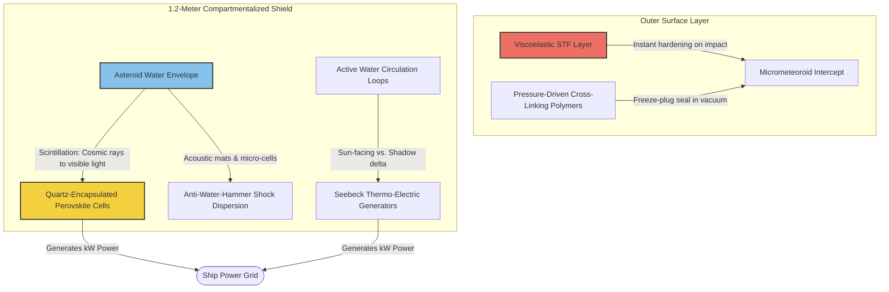
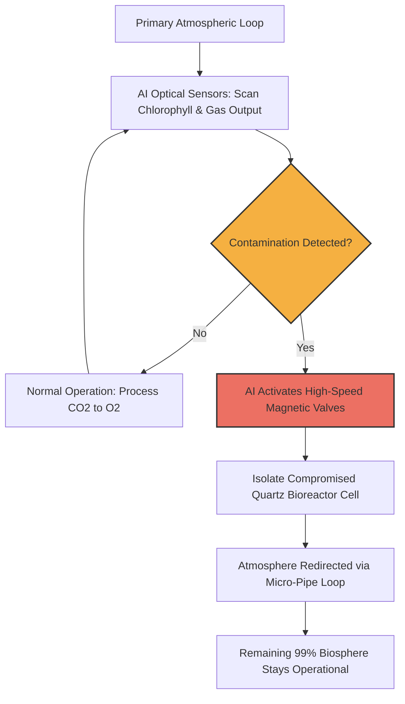

# 🚀 Dual-Stage Water Shield: Tandem Energy Converter & Autonomous Life Support

This project introduces a high-logic, multi-functional closed-loop ecosystem optimized for station-to-station transit vessels and orbital space stations. Operating entirely on physical, thermodynamic, and cellular principles, the architecture utilizes an optimized 1.2-meter compartmentalized water shield encapsulated by a self-healing surface matrix to neutralize cosmic radiation, harvest multi-source tandem energy, and execute autonomous biological life support.

---

## 🛠️ 1. Mechanical & Tandem Energy Architecture

The spacecraft hull is encapsulated by an optimized 1.2-meter (120 cm) compartmentalized composite shell. This thickness serves as the mechanical and thermal "sweet-spot," balancing heavy radiation shielding with agile reaction control speed during high-speed orbital maneuvers.

*   **Tandem Power Harvesting:** The system extracts clean energy from environmental hazards on two simultaneous layers:
    1.  **Photo-Electric Layer (Perovskite Matrix):** The hydrogen-rich asteroid water envelope intercepts cosmic rays, shifting ionizing radiation down into visible light via the scintillation effect. Submerged, quartz-encapsulated Perovskite solar cells absorb this light, converting it into electricity.
    2.  **Thermo-Electric Layer (Seebeck Circulation):** Deep space creates extreme temperature differentials between the sun-facing hull (hot) and shadow sectors (cold). By actively circulating warm water through the compartmentalized loops, the ship balances its internal temperature completely passively, while integrated thermo-electric generators harvest the temperature delta directly into additional kW power.
*   **The Anti-Water-Hammer Matrix:** The liquid bulk is divided into hundreds of isolated micro-compartments and acoustic damping mats. When docking with high-speed orbital structures, structural kinetic shockwaves are instantly dispersed across the cell walls, preventing destructive water-hammer effects and protecting delicate internal electronics.

---

## 🛡️ 2. Self-Healing Surface Membrane (Impact Autogenous Seal)

To prevent catastrophic fluid decompression caused by high-velocity micrometeoroids or space debris punctures, the absolute outer surface of the 1.2-meter shield is lined with an autogenous self-healing material matrix operating in tandem with the inner fluid dynamics:

*   **Viscoelastic Shear-Thickening Fluid (STF):** The outer skin features a high-density, polymer-based self-healing gel layer. Under normal conditions, the material remains highly flexible and viscoelastic. However, upon high-velocity impact, the immense mechanical shear force forces the molecules to instantly lock together, forming a temporary solid barrier around the puncture zone to minimize initial mass loss.
*   **Pressure-Driven Cross-Linking:** When a micro-debris puncture breaches the core water envelope, the internal hydro-pressure forces the escaping water and embedded bio-polymers outward into the vacuum of space. As the specialized fluid compounds encounter the drop in pressure and thermal temperature shift at the exit wound, a rapid chemical cross-linking polymerization is triggered.
*   **Instant Freeze-Plug Seal:** The expanding cross-linked gel reacts with the freezing void, curing within seconds to form a permanent, airtight, and structurally sound plug. The hull heals its own puncture autonomously without requiring spacewalks or human maintenance.

---

## 🧬 3. Atmospheric Integration & Bio-Compartments (AI-Isolated Networks)

*   **Parallelized Quartz Bioreactor Cell Units:** The life-support bio-envelope does not rely on a single large reservoir. Instead, it is divided into a parallelized network of independent, compact bioreactor tubes constructed from high-purity **quartz glass**. Quartz ensures 100% UV/visible light transmission from the scintillation layer directly into the *Chlorella* algae cultures while serving as a chemically inert, rigid boundary.
*   **The AI-Monitored Isolation Bypass (Emergency Cut-Off):** Each individual quartz cell is equipped with a dedicated, electronically controlled bypass micro-pipe loop monitored 24/7 by the ship's local 0-latency AI network.
    1.  **Spectroscopic Monitoring:** The AI uses optical sensors to continuously scan the health, chlorophyll density, and metabolic gas output of each parallel quartz cell.
    2.  **Instant Contamination Intercept:** If radiation mutation, viral infection, or bacterial contamination is detected in a specific cell, the AI triggers a high-speed magnetic valve within milliseconds.
    3.  **Complete Isolation:** The compromised quartz unit is immediately cut off and sealed from the primary atmospheric circulation loop. The air and greywater lines bypass the infected module entirely, keeping the remaining 99% of the parallelized biosphere perfectly clean, unpolluted, and operational.
*   **Atmospheric Lifeline:** The active, healthy algae cells continue processing carbon dioxide ($CO_2$) exhaled by the crew back into breathable oxygen ($O_2$) without any pressure drops during isolation events.

---

## 🏋️‍♂️ 4. Cellular-Level Bio-Protection Protocol (Immersion Training)

To accelerate DNA and cellular repair from deep-space radiation, the crew undergoes a proactive cellular conditioning protocol that operates in tandem with the ship's biological life support:

1.  **Fluid Immersion Training:** Astronauts execute physical exercises inside localized fluid immersion tanks (leveraging Pascal's Principle to equalize mechanical stress across the entire body substrate).
2.  **Hypoxic Mountain-Mask Simulation:** During the immersion training, the crew wears specialized resistance masks that simulate a low-oxygen (hypoxic), high-altitude atmosphere. This controlled, non-destructive stress environment forces the human biological system into immediate **Autophagy**.
3.  **The Autophagic Cleaning Cycle:** Autophagy acts as the body's internal recycling mechanism, rapidly dismantling and digesting damaged proteins, mutated cellular walls, and radiation-induced DNA errors caused by any leaking cosmic rays.
4.  **Hypoallergenic Rebuilding:** Immediately post-training, when cells are hyper-receptive to nutrient uptake, the crew is fed a specialized blend of plant- and seed-based proteins (such as hemp and bioreactor-grown algae). This hypoallergenic, zero-animal-protein matrix completely eliminates structural immune rejection or allergic shock risks, allowing the body to rapidly construct new, radiation-free cellular tissue.

---

## 📄 License

This project is licensed under the **MIT License** – preserving the original architecture credited to the creator.

Copyright (c) 2026 masakertsa
